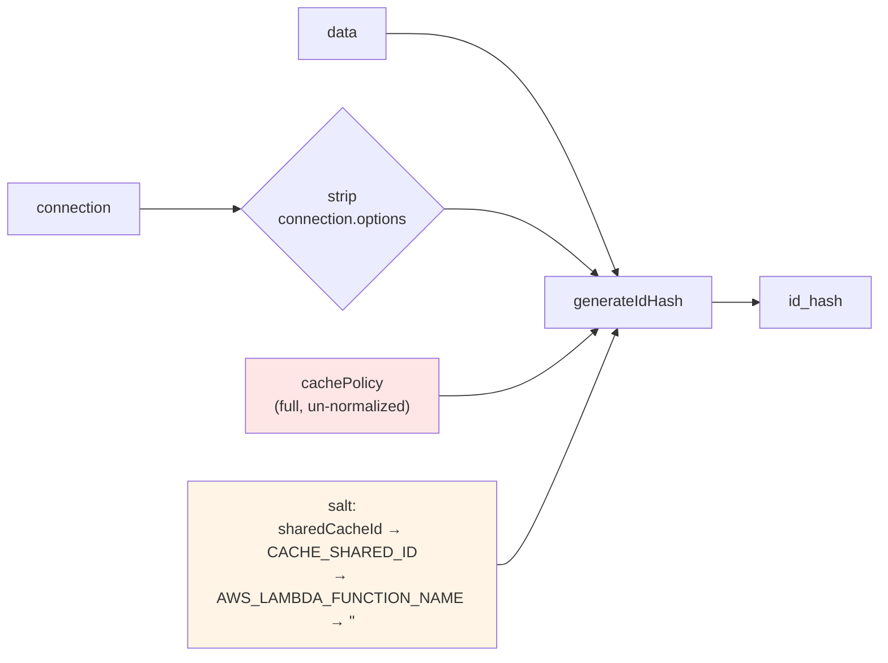

# Design Document: Cache Key Generation Documentation Correction

## Overview

The "Cache Key Generation" section of `docs/features/cache/README.md` (line 576-581) describes the `id_hash` inputs more narrowly than the implementation. It names only four `connection` fields and omits `data` and `cachePolicy` entirely. Because `cachePolicy` flows into the hash in full, two Lambda functions configured to share a cache entry via `sharedCacheId` will silently read and write different rows if any cache-profile field drifts between them — the failure mode reported in [issue #235](https://github.com/63Klabs/cache-data/issues/235).

This is a documentation-only change. No runtime behavior changes, no API changes, no version-affecting code changes. Three follow-up items raised in the issue (env var mismatch, debug logging, stricter cache identity) are investigated and dispositioned here, not implemented.

### Design Decisions

1. **Document reality, not intent.** The current hash semantics are load-bearing for every existing cache entry in every consumer. Changing what feeds the hash would invalidate all caches in the field. The docs are corrected to match the code; the question of whether the semantics *should* change is recorded as a separate major-version proposal (FR8).
2. **Correct the stale `generateIdHash` JSDoc too.** FR5 only asks that `getIdHash`'s JSDoc be confirmed accurate (it is). But `generateIdHash`'s JSDoc is actively wrong in a way that caused the same misunderstanding, so it is brought into scope. Both are doc-comment-only edits.
3. **Lead the shared-cache section with the pitfall, not the happy path.** The existing "Two Lambda Functions Sharing Cache" example uses an inline cache profile in both functions, which sidesteps the drift risk. A callout is added rather than rewriting the example, so the example stays readable while the hazard becomes impossible to miss.
4. **Do not fix the `useToolsHash` env var bug in this spec.** It is a real behavior bug, but the already-filed `1-4-x-fully-implement-hashThisData` spec removes the flag entirely, which makes a point fix wasted work. See [FR6 disposition](#fr6-usetoolshash-environment-variable-mismatch).

## Verification of Actual Behavior (FR1)

Verified by reading `src/lib/dao-cache.js` and by executing `Cache.generateIdHash` directly. Line numbers are current as of this spec.

### What is hashed

`CacheableDataAccess.getData` builds the id object at `src/lib/dao-cache.js:3284`:

```javascript
const idToHash = { data: data, connection: connection, cachePolicy: cachePolicy };
const cache = new Cache(idToHash, cachePolicy);
const idHash = cache.getIdHash();
```

The `Cache` constructor forwards that composite object to `Cache.generateIdHash` at line 1588. `cachePolicy` is passed **by reference, exactly as the caller supplied it** — un-normalized and un-defaulted. The constructor's cache-profile casting (lines 1556-1585) writes to private instance fields only and never mutates the object being hashed.

`generateIdHash` (lines 1986-2034) performs exactly three transformations before hashing:

| Step | Effect |
|:-----|:-------|
| `removeFunctions(idObject)` | Strips function-valued properties at any depth |
| `structuredClone(...)` | Deep clone so the caller's object is not mutated |
| `delete clonedIdObject.connection.options` | The **only** key-based exclusion, and only when `connection.options` is truthy |

Nothing under `cachePolicy` is stripped. Both backends then walk the entire remaining object: `object-hash` with `{respectType, unorderedSets, unorderedObjects, unorderedArrays}` all `true`, or `tools.hashThisData` (`src/lib/tools/utils.js:257`) which recursively sorts keys and digests the result.

**Effective hash inputs:** `data`, `connection` minus `connection.options`, the full `cachePolicy`, and the salt.

### Salt resolution

Confirmed at `src/lib/dao-cache.js:2011` combined with `Cache.init` lines 1670-1678:

1. `sharedCacheId` parameter to `Cache.init()` — used when present and not `null`/`undefined`; non-string throws.
2. `CACHE_SHARED_ID` env var — used when `!== undefined`, so `CACHE_SHARED_ID=""` is a *configured* empty salt.
3. `AWS_LAMBDA_FUNCTION_NAME` env var.
4. `""`.

The README's existing "Priority Resolution Order" list (lines 354-360) is already correct. One undocumented caveat: `Cache.init`'s `inMemoryOnly` guard clause returns at line 1657, **before** the `sharedCacheId` block, so in in-memory-only mode `sharedCacheId` and `CACHE_SHARED_ID` are never applied.

### Empirical confirmation

Executed against the working tree with `sharedCacheId: "shared-group"`, a fixed `connection` of `{host: "internal", path: "org_index"}`, and the writer/reader profiles from the issue report:

| Scenario | Hash changes? |
|:---------|:--------------|
| Reader profile adds `defaultExpirationExtensionOnErrorInSeconds: 30` | **yes** — reproduces the reported production failure |
| `encrypt` omitted vs. `encrypt: true` explicitly | **yes** — absent ≠ explicit default |
| Alias `defaultExpiresInSeconds: 60` vs. canonical `defaultExpirationInSeconds: 60` | **yes** — behaviorally identical, different key |
| `connection.options` added with `forceRefresh`/`timeout` | no — confirms the documented exclusion |
| `data` changed from `null` to `{a: 1}` | **yes** — confirms `data` participates |

The last two lines are also pinned by existing tests: `test/cache/force-refresh/property/force-refresh-property-tests.jest.mjs` (Property 3, 100 runs) asserts hash stability across `options.forceRefresh` variation.

### Consequences worth documenting

Beyond the reported field-drift case, three non-obvious consequences follow from `cachePolicy` being hashed un-normalized:

- **Absent ≠ default.** Omitting a field and passing its default value produce different keys.
- **Alias ≠ canonical.** The backwards-compatible aliases produce different keys than their canonical counterparts.
- **Unread fields still count.** Keys that `Cache` never reads (`profile`, `hostEncryption`, arbitrary annotations) are hashed. `Connections.getCacheProfile()` returns whatever object was configured, so these flow straight through.

## Architecture



The highlighted node is what the current documentation omits.

## Components and Interfaces

### Modified: `docs/features/cache/README.md`

#### 1. Replace "Cache Key Generation" (lines 576-581)

Replaces the two existing paragraphs. Retains the final claim about multiple caches in a single store, which remains true.

> ### Cache Key Generation
>
> The `id_hash` for a cache entry is derived from three inputs together with a salt:
>
> 1. The `data` parameter passed to `CacheableDataAccess.getData()`
> 2. The `connection` object — all fields except `connection.options`, which is intentionally excluded so runtime toggles like `forceRefresh` and `timeout` do not shift the key
> 3. The full `cachePolicy` object, including behavioral fields such as `defaultExpirationInSeconds`, `defaultExpirationExtensionOnErrorInSeconds`, `expirationIsOnInterval`, `overrideOriginHeaderExpiration`, `encrypt`, `hostId`, `pathId`, `headersToRetain`, and `profile`
>
> The salt is resolved from `sharedCacheId` → `CACHE_SHARED_ID` env var → `AWS_LAMBDA_FUNCTION_NAME` → `""`. Function-valued properties are stripped before hashing; object key order and array order do not affect the result.
>
> The `cachePolicy` object is hashed **exactly as you supply it**, with no normalization or defaulting. Three consequences follow:
>
> - Omitting a field is not the same as passing its default. `{hostId: "x"}` and `{hostId: "x", encrypt: true}` produce different keys even though `encrypt` defaults to `true`.
> - Backwards-compatible aliases are not interchangeable with canonical names. `defaultExpiresInSeconds: 60` and `defaultExpirationInSeconds: 60` behave identically but produce different keys.
> - Fields the cache never reads are still hashed, including `profile` and any annotations of your own.
>
> **Consequence for shared caches:** two Lambda functions that want to share a cache entry must use byte-identical `connection` (minus `options`) and `cachePolicy` objects in addition to the same `sharedCacheId`. Any drift in a cache-profile field — even a purely operational one like `defaultExpirationExtensionOnErrorInSeconds` — produces a different `id_hash`, and the functions will silently read and write different rows.
>
> Because the salt is included, and applications use their own encryption key, you can safely store multiple application caches in a single DynamoDB/S3 cache store.

The phrase "Lambda Application Identifer" is dropped (it is also a typo in the current text and does not correspond to anything in the code).

#### 2. Add "Shared cache pitfalls" to the "Shared Cache" section

Inserted after the "Example: Two Lambda Functions Sharing Cache" subsection, replacing the existing shared-expiration warning blockquote with a fuller callout that keeps that warning as one of its items.

> ##### Shared Cache Pitfalls
>
> Matching `sharedCacheId` is necessary but **not sufficient**. Functions sharing an entry must also agree on the `connection` and `cachePolicy` objects, because both are hashed into the key.
>
> The example above is deliberately simple: both functions declare the same cache profile inline. Real projects usually define profiles in a per-function `connections.js`, which is where drift creeps in.
>
> **How this fails:** a writer (scheduled refresh) and a reader (API) share an entry. Someone adds `defaultExpirationExtensionOnErrorInSeconds: 30` to the reader's profile only. Nothing else changes — same `sharedCacheId`, same table, same bucket, same key, same connection. From that moment the two functions use different `id_hash` values. The writer's data lands in DynamoDB correctly and the reader never sees it. The reader observes a permanently empty cache and falls through to its miss or error path on every request, indefinitely. There is no error and no warning.
>
> **To avoid it:**
>
> - Define the shared cache profile and connection in one place and import them into every function that shares the entry, rather than duplicating the literals.
> - Treat any edit to a shared cache profile as a cache-invalidating change, even when the edit looks purely operational.
> - When a reader reports a cache that is always empty while the writer reports successful writes, compare the `id_hash` values from both functions' logs first. `CacheableDataAccess.getData` logs it on every call under the `CACHE` tag.
> - Remember that behavioral fields are part of the key, so consumers cannot currently tune error TTL or interval behavior independently while still sharing an entry.
>
> **Shared expiration:** sharing a cache also means sharing its expiration. The first function to populate an entry determines the expiration all consumers see until that entry expires.

#### 3. Fix the `useToolsHash` env var rows

Lines 255, 307, and 338 disagree about whether the env var is `CACHE_DATA_USE_TOOLS_HASH` or `CACHE_DATA_USE_TOOLS_HASH_METHOD`. Neither name works alone (see FR6). Per design decision 4, the docs will present the `useToolsHash` **init parameter** as the supported switch and annotate the env var as not reliably honored, with a pointer to the pending removal. No code change.

### Modified: `src/lib/dao-cache.js` — doc comments only

#### `Cache.generateIdHash` JSDoc (lines 1915-1985)

Four inaccuracies to correct:

| Current text | Problem |
|:-------------|:--------|
| `{ query: query, connection: connection, cachePolicy: cachePolicy }` | The code builds `{ data, connection, cachePolicy }` (line 3284) |
| `@example` using `cachePolicy: { ttl: 300 }` | `ttl` is not a recognized cache-profile field |
| Describes `object-hash` only | Omits the `tools.hashThisData` path, the salt, and the `connection.options` exclusion |
| "Algorithm used is set in Cache object constructor" | The algorithm is a static set in `Cache.init`, not the constructor |

#### `Cache.getIdHash` JSDoc (lines 2808-2817) — FR5

Current text says the hash "is generated from the connection, data, and cache policy parameters." This is **accurate** and consistent with the revised README. One addition proposed: a sentence noting that `connection.options` is excluded and that the salt participates, so a reader of the JSDoc alone reaches the same conclusion as a reader of the README.

### Not modified

`src/lib/dao-cache.js` behavior, `types/`, `src/lib/tools/utils.js`. Public API unchanged.

## Follow-Up Dispositions

### FR6: `useToolsHash` environment variable mismatch

**Confirmed, with a corrected location.** The issue reports ~L1536; the actual code is at `src/lib/dao-cache.js:1632-1633`:

```javascript
this.#useToolsHash = ( "useToolsHash" in parameters ) ? Cache.bool(parameters.useToolsHash) : 
    ("CACHE_DATA_USE_TOOLS_HASH" in process.env ? Cache.bool(process.env.CACHE_DATA_USE_TOOLS_HASH_METHOD) : false);
```

The gate tests for the **presence** of `CACHE_DATA_USE_TOOLS_HASH` but reads the **value** of `CACHE_DATA_USE_TOOLS_HASH_METHOD`. Verified by executing `Cache.init` under four env combinations:

| Environment | `useToolsHash` resolves to |
|:------------|:---------------------------|
| `CACHE_DATA_USE_TOOLS_HASH_METHOD=true` only | `false` — gate key absent |
| `CACHE_DATA_USE_TOOLS_HASH=true` only | `false` — `_METHOD` undefined |
| Both `=true` | `true` |
| `CACHE_DATA_USE_TOOLS_HASH=false`, `_METHOD=true` | `true` — gate only checks presence, so the `false` is ignored |

The init parameter path is unaffected and works correctly. No test covers this branch.

**Disposition: do not file a new bug; fold into the existing `1-4-x-fully-implement-hashThisData` spec.** That spec already removes the `useToolsHash` parameter and `CACHE_DATA_USE_TOOLS_HASH` env var outright and makes `hashThisData` unconditional, which resolves the mismatch by deletion. A point fix now would be reverted by that work. This spec contributes only the documentation correction described above, plus a note to be added to that spec recording the verified behavior table so the removal work has the evidence on hand.

Severity is low in practice: the flag is off by default, flipping it invalidates every existing cache entry anyway (the two backends produce different digests for identical input), and the parameter path works.

### FR7: Debug logging of the computed `id_hash`

**Already available; no change recommended.** `getData` logs the hash on every non-throwing call at `src/lib/dao-cache.js:3351` under the `CACHE` tag:

```javascript
tools.DebugAndLog.log(`${idHash} | ${tags.path} | ${cache.getStatus()} | ${timer.elapsed()}`, "CACHE");
```

It also appears in both error paths (lines 3334 and 3340). This is normal-level logging, not debug-gated, so the hash was recoverable from CloudWatch during the reported incident without a code change — the gap was that nobody knew to compare the two values, which the new troubleshooting bullet in the pitfalls callout addresses.

Logging a **summary of the object that produced the hash** was evaluated and is **not recommended**: `connection` routinely carries authorization headers and query parameters, and `data` is caller-controlled. Emitting it, even at debug level, risks leaking credentials into CloudWatch. If diagnosability proves insufficient, the safer shape is a separate spec for a debug-only log of the hashed object's *key structure* with values elided.

### FR8: Stricter cache identity proposal

**Recorded, not implemented.** Restricting the `cachePolicy` contribution to identity-bearing fields only — e.g. `hostId`, `pathId`, `encrypt`, `profile` — while letting behavioral fields govern only how an entry is served and expired, would make shared caching far more forgiving and let each consumer tune error and interval behavior without splitting the entry.

This is a breaking change on two counts: it changes every computed `id_hash` (invalidating all caches in the field on upgrade) and it changes what "the same cached thing" means. It requires a major version bump, a migration note, and a decision about whether a transitional dual-read is warranted. Open questions to resolve before committing: whether `encrypt` belongs in identity (it determines at-rest representation, so arguably yes), whether `headersToRetain` belongs (it shapes the stored payload, so arguably yes), and whether unrecognized caller-supplied fields should be ignored or hashed. No implementation in this spec.

## Correctness Properties

*A property is a characteristic or behavior that should hold true across all valid executions of a system — essentially, a formal statement about what the system should do. Properties serve as the bridge between human-readable specifications and machine-verifiable correctness guarantees.*

These properties constrain the **documentation** against the **implementation**, in the spirit of the existing `test/documentation/property/` suite.

### Property 1: Documented hash inputs are complete

*For any* top-level key in the id object constructed by `CacheableDataAccess.getData` (`data`, `connection`, `cachePolicy`), the "Cache Key Generation" section of `docs/features/cache/README.md` SHALL name that key as a hash input.

**Validates: Requirements FR2**

### Property 2: Documented exclusions match code exclusions

*For any* path deleted from the cloned id object by `Cache.generateIdHash`, the documentation SHALL name that path as excluded; and *for any* path the documentation names as excluded, `generateIdHash` SHALL in fact exclude it. Currently this set is exactly `{connection.options}`.

**Validates: Requirements FR2**

### Property 3: Documented behavioral fields are hash-affecting

*For any* `cachePolicy` field name enumerated in the revised "Cache Key Generation" section, two otherwise-identical calls to `Cache.generateIdHash` that differ only in that field's presence or value SHALL produce different hashes.

**Validates: Requirements FR2, FR3**

### Property 4: Documented salt order matches resolution order

*For any* combination of configured and unconfigured salt sources (`sharedCacheId` parameter, `CACHE_SHARED_ID`, `AWS_LAMBDA_FUNCTION_NAME`), the salt that `generateIdHash` actually applies SHALL be the first configured source in the order documented in the README.

**Validates: Requirements FR2**

### Property 5: Profile drift splits the cache key

*For any* cache profile `P` and any recognized cache-profile field `f` not already present in `P`, adding `f` to `P` with any value SHALL change the computed `id_hash` for an otherwise-identical request under an identical `sharedCacheId`. This is the formal statement of the reported failure mode and of the consequence documented under FR3 and FR4.

**Validates: Requirements FR3, FR4**

### Property 6: README and JSDoc agree on hash inputs

*For any* hash input named in the `Cache.getIdHash` or `Cache.generateIdHash` JSDoc, the "Cache Key Generation" section SHALL name the same input, and vice versa.

**Validates: Requirements FR5**

## Testing Strategy

### Scope

This change edits Markdown and JSDoc comments. No runtime code paths change, so no new behavioral tests are required. The properties above are candidates for the existing documentation-validation suite; Properties 3, 4, and 5 are the ones with real value, since they would have caught the original discrepancy.

### Recommended new tests

| Property | Location | Approach |
|:---------|:---------|:---------|
| 3, 5 | `test/documentation/property/cache-key-inputs-property-tests.jest.mjs` (new) | fast-check over recognized cache-profile field names and generated values; assert `generateIdHash` differs. 100 runs. No subprocess needed — `generateIdHash` is static and salt-independent for difference assertions. |
| 4 | Already covered | `test/cache/cache-shared-id-property-tests.jest.mjs` Properties 3, 4, 6 cover the resolution order via subprocess isolation. No new test needed. |
| 1, 2, 6 | `test/documentation/property/cache-key-inputs-property-tests.jest.mjs` (new) | Parse the README section and the two JSDoc blocks; assert the named input sets match each other and the `idToHash` literal. |

Tag format: `Feature: cache-key-generation-docs, Property {number}: {property_text}`

### Existing tests that must continue to pass

- `test/documentation/property/documentation-link-validity-tests.jest.mjs` — the new callout adds no new links, but the section anchors change.
- `test/documentation/property/jsdoc-no-hallucination-tests.jest.mjs` and `jsdoc-completeness-tests.jest.mjs` — the `generateIdHash` JSDoc edits must not drop required tags.
- `test/documentation/property/feature-documentation-configuration-coverage-tests.jest.mjs` — the `useToolsHash` env var row edits touch the configuration table this test reads.
- `test/cache/force-refresh/property/force-refresh-property-tests.jest.mjs` Property 3 — pins the `connection.options` exclusion that the revised docs now assert.

Full suite via `npm test` before commit, per the project test requirements.

### Verification approach for doc accuracy

Every factual claim in the new README text traces to either a cited line in `src/lib/dao-cache.js` or a row in the empirical table above. Claims that cannot be traced that way are not included.

## Version and Changelog

Documentation-only, so this is a PATCH-level change under semver. The spec directory is named `1-4-0-...` while `package.json` currently reads `1.3.17`; the naming convention requires the current version prefix. Flagging rather than renaming, since the directory may have been named deliberately to batch with other `1.4.0` work. `CHANGELOG.md` entry belongs under `Fixed` (documentation corrected to match implementation), referencing issue #235.
